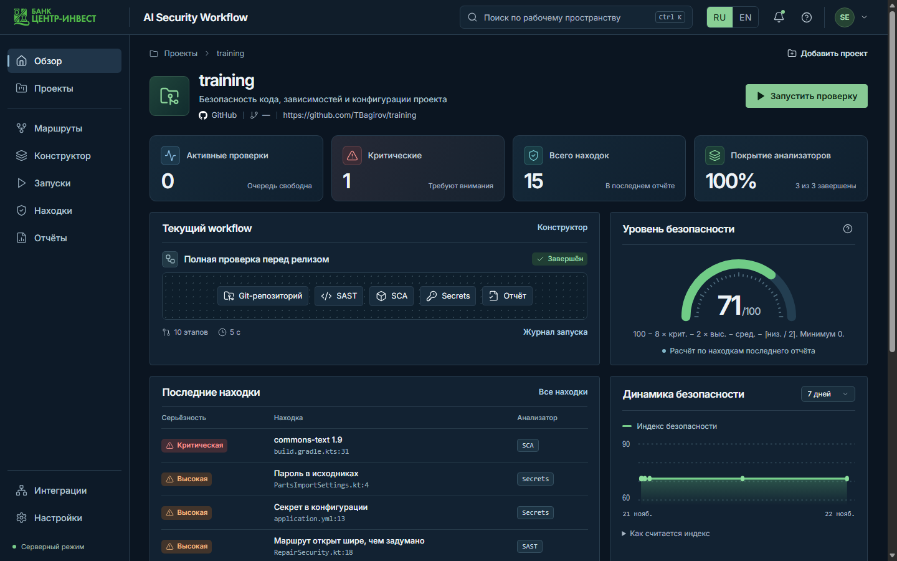
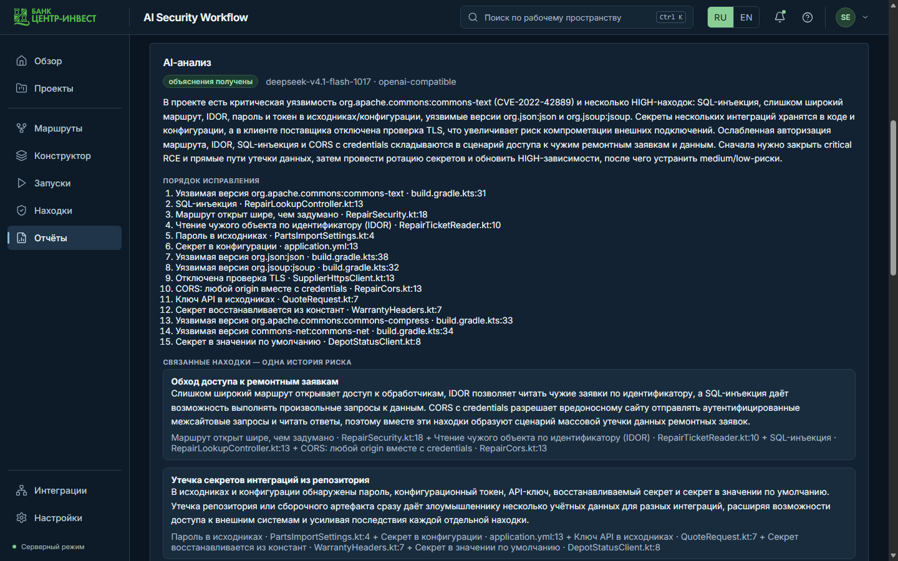
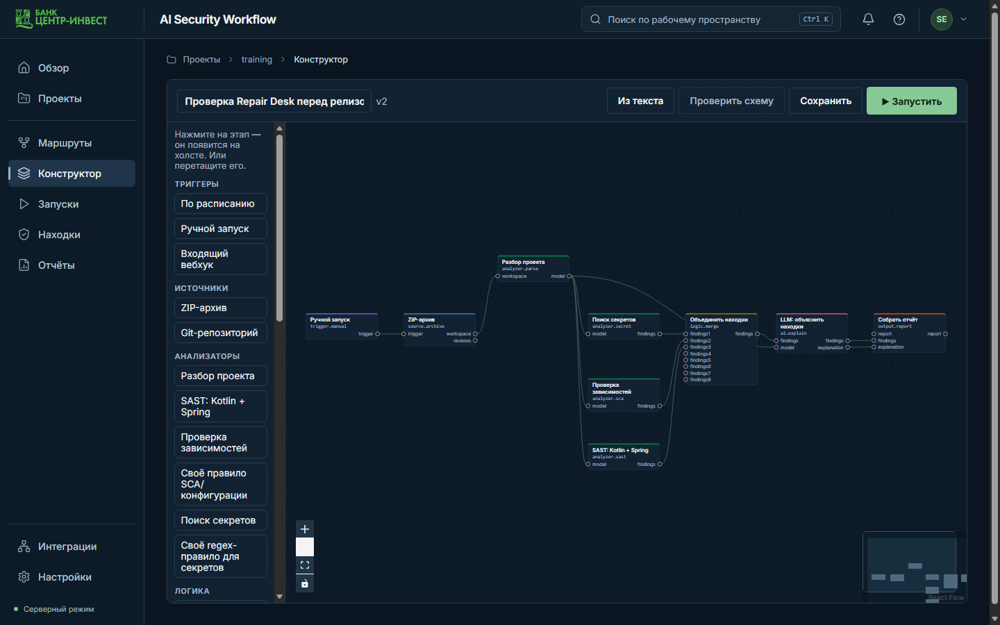
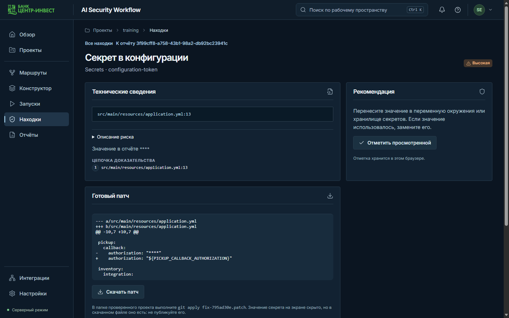
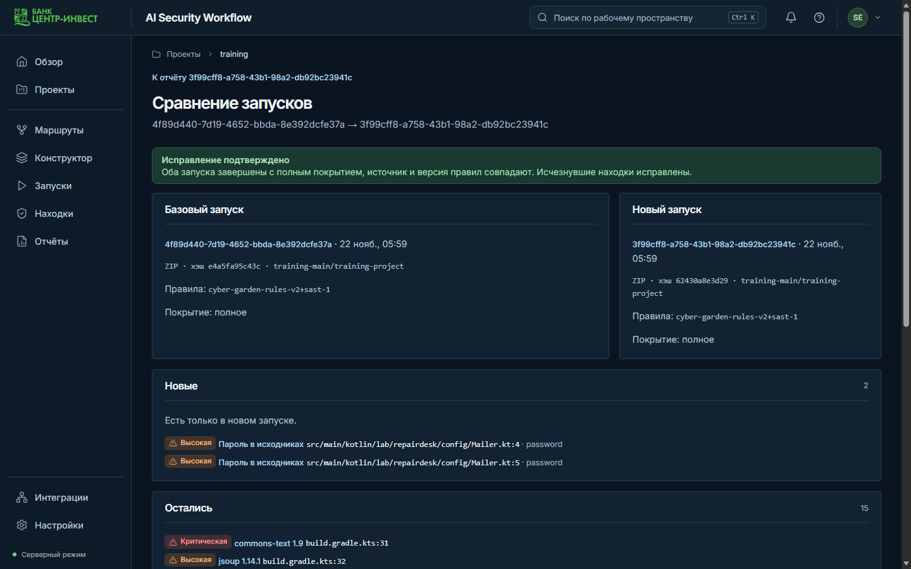

# Codeguard — визуальная платформа проверки безопасности Kotlin/Spring Boot

> Лицензия: проприетарная, все права защищены. Исходный код предоставлен только для ознакомления и оценки жюри, см. [`LICENSE`](LICENSE).

## Инструкция по запуску

**Требования** (достаточно одного из вариантов): Docker, либо JDK 21 + Node.js 20+. LLM и Telegram необязательны: без них работают сканеры, отчёты и интерфейс.

**Способ 1. Docker (рекомендуется).**

```bash
docker compose up --build
```

Откройте http://127.0.0.1:8080 (порт открыт только на localhost; первая сборка занимает несколько минут).

**Способ 2. Windows без Docker.** Двойной щелчок по `Start-Codeguard.bat` (нужны JDK 21 и Node.js 20+; порт задаётся переменной `PORT`). На Linux/macOS: `bash scripts/start.sh`.

**Способ 3. Вручную.**

```bash
cd frontend && npm ci && npm run build && cd ..   # собранный интерфейс встраивается в JAR
./gradlew --no-daemon :backend:app:bootJar
java -jar backend/app/build/libs/app-0.1.0-SNAPSHOT.jar   # http://127.0.0.1:8080
```

Для разработки интерфейса отдельно: `cd frontend && npm ci && npm run dev` (Vite на http://localhost:5173 проксирует `/api` на бэкенд; `npm run dev:demo` работает без бэкенда, на фикстурах).

**Настройки (необязательно).** `cp .env.example .env` и при необходимости заполните. Ключ шифрования секретов `APP_SECRETS_KEY`: `node -e "console.log(require('crypto').randomBytes(32).toString('base64'))"` или `openssl rand -base64 32`. Ключ LLM и токен Telegram-бота задаются там же либо в интерфейсе («Настройки»).

**Как проверить работу за 2 минуты.** Откройте «Шаблоны», выберите «Полная проверка перед релизом», вставьте ссылку на любой публичный Kotlin/Spring/Gradle-репозиторий (или загрузите ZIP проекта) и нажмите «Запустить». Статусы нод идут в реальном времени; по окончании откроется отчёт с находками, цепочками доказательств, покрытием и PDF/Markdown/SARIF. Готовый пример проекта: `fixtures/training/sample-project` (заархивируйте папку в ZIP).

**Тесты.**

```bash
./gradlew --no-daemon test                     # бэкенд
cd frontend && npm run typecheck && npm run lint && npm test && npm run build
```

Проверка точности — раздел «Доказательства точности» ниже.

## Что умеет

- **Конструктор сценариев** на React Flow: нода → порты → связи, серверная проверка графа, шаблоны, импорт и экспорт YAML, поиск по Ctrl K.
- **Собственные анализаторы** SECRET, SCA и SAST (SAST — на Kotlin PSI) без Semgrep, Gitleaks, Trivy и чужих правил; у каждой находки цепочка доказательств и явное покрытие COMPLETE / PARTIAL / FAILED.
- **AI объясняет, но не решает**: ответ LLM проходит проверку схемы и ссылок на реальные находки, выдуманные CVE и места в коде вырезаются; без LLM платформа работает.
- **Сценарий из текста** (text-to-workflow) и 9 готовых шаблонов: релиз, ежедневные секреты, CI, PR → Telegram, карта маршрутов, решение по критичной находке, качество кода.
- **CI с gate и SARIF**: `pass=false` при критичной находке или неполном анализе, SARIF 2.1.0 для GitHub Code Scanning, HMAC-вебхуки.
- **Telegram-карточка** со счётчиками и приоритетами, кнопки решения по находке (`approval.wait`), почта.
- **Тесты-доказательства в песочнице**: проверка находки изолированно, без записи в проект.
- **Карта маршрутов** Spring Security: какой эндпоинт открыт кому и какие находки на него попали.
- **Сравнение запусков** — «исправление подтверждено», только если покрытие полное, источник и версия правил совпадают.
- **Готовый патч** для находки (SECRET, SCA) в виде unified diff, SBOM CycloneDX 1.5, нода качества кода (синтаксис, типы, ссылки).
- **Локальная LLM** (Ollama, vLLM, любой OpenAI-совместимый адрес на loopback) — код не уходит наружу.
- **Защита от prompt injection**: код и пути проекта идут в модель только как данные в отдельном блоке; ответ, который «снимает» находку, отклоняется — 16/16 атак, 0 ложных отказов на 109 реальных ответах.
- **PDF-отчёт и Telegram**: любой набор вложений (PDF, Markdown, HTML, JSON, SARIF), сотни получателей, повтор при ограничении частоты; секреты замаскированы в каждом файле. RU | EN интерфейс.

## Любой репозиторий — честно и без зависаний

Принесите проект на любом стеке — Kotlin, Java, C++, Python, Go, TypeScript или смешанный. Платформа:

- **всегда завершается**: разбор ограничен по времени (60 с), размеру файла (1 МБ) и числу файлов (20 000); бинарники, шрифты, картинки, `node_modules`, `vendor`, `build` пропускаются и перечисляются в покрытии; любая ошибка этапа завершает этап, а не зависает запуск; лимит времени запуска срабатывает всегда — с названием этапа;
- **показывает «Языки проекта»**: сколько файлов каждого языка и что из этого анализировалось;
- **ищет секреты в любом языке**: форматы ключей AWS, GitHub, Slack, Google, Stripe, пароль в URL, приватные ключи PEM, случайные строки рядом со словами password / token / secret;
- **не притворяется**: Maven, npm, pip, Go, Cargo, NuGet и другие экосистемы — «не поддерживается», Java/C++/… — «N файлов не анализируются», статус PARTIAL с причиной, а не «чисто».

Пример: Maven/Java-репозиторий из 320 Java- и 67 TypeScript-файлов — 5–6 с, PARTIAL, языки и причины в отчёте. Ссылку, вставленную пользователем, отдельно «разрешать» не нужно: вставили — подключено (вебхуки, CI и расписание пускают только подключённые репозитории).

## Как выглядит







Ещё: [выполнение по этапам](docs/screenshots/02-run-stages.png), [карта маршрутов](docs/screenshots/06-route-map.png), [шаблоны](docs/screenshots/07-templates.png), [отчёт с интерфейсом на английском (переключатель RU | EN)](docs/screenshots/08-report-en.png). Снимки сделаны на учебном проекте, запущенном по ссылке на GitHub; AI-раздел отчёта — ответ реальной LLM (deepseek-v4.1-flash, OpenAI-совместимый API), находки определили анализаторы.

## Доказательства точности

Все цифры из [`docs/research/metrics.md`](docs/research/metrics.md) (проверка на сборке JAR, отчёт сверяется evaluator'ом из `tools/evaluator`).

| Корпус | Результат | Ложные срабатывания |
|---|---|---|
| Учебный проект (15 классов) | 15 из 15 | 0 |
| Вариации SECRET/SCA, 24 проекта | 38 из 38 | 0 на 32 безопасных контролях |
| Вариации SAST, 24 проекта | 83 из 83 | 0 на 91 безопасном контроле |
| Внешний набор: 3 проекта, собраны другими авторами, свои эталоны | 30 из 31 (не найден только `csrf().disable()` — вне классов учебного набора) | 0 |
| Три слепых набора (по 2 проекта) | SECRET 30 из 30, SAST 29 из 30 | 0 |
| Безопасные контроли суммарно | — | 0 на 129 |

Готовые сканеры на том же учебном эталоне (по 5 находок на категорию): Semgrep с правилами по умолчанию нашёл 0 из 5 SAST (со своими правилами — 2 полностью, 2 частично); Gitleaks — 2 из 5 секретов (со своими правилами — 4); OSV-Scanner — 5 из 5 SCA. Наши анализаторы: 5/5 в каждой категории.

Повторить (нужны JDK 21 и Python 3.10+, собранный `:backend:app:bootJar`):

```bash
./gradlew :backend:app:bootJar
python -X utf8 -B backend/analyzers/sast/scripts/variants_e2e.py \
  --jar backend/app/build/libs/app-0.1.0-SNAPSHOT.jar --java <путь к java 21>
python -X utf8 -B tools/evaluator/evaluate.py <report.json полного графа на учебном проекте>
```

Честная оговорка: вариации SECRET/SCA и SAST написаны нами, правила дорабатывались вместе с ними, поэтому 100% на них — регрессионная проверка устойчивости к переименованиям и переносу кода. Обобщение показывают внешний и слепые наборы: там цифры ниже 100%, и мы их не скрываем. Скрытый набор нам неизвестен.

## Как это работает

1. Триггер (вручную, по расписанию, вебхук GitHub) запускает сценарий; источник — ZIP или публичный Git-репозиторий, разрешённый списком.
2. Нода разбора строит ProjectModel: исходники Kotlin (PSI), конфигурация, Gradle, Spring, SQL.
3. SECRET, SCA и SAST работают параллельно на одной модели, только читают проект и возвращают находки в формате `contracts/finding.schema.json`.
4. `logic.merge` объединяет находки; дедупликация, фильтры и условия — отдельные ноды логики.
5. AI-нода объясняет находки; валидатор принимает или отклоняет объяснение, но не меняет состав находок.
6. Отчёт (Markdown, SARIF, SBOM) и уведомление: Telegram, почта, статус CI.
7. Движок стримит статусы нод по SSE, история и сравнение запусков хранятся в H2.

Подробнее — [`docs/ARCHITECTURE.md`](docs/ARCHITECTURE.md), контракты — [`contracts/`](contracts/), REST — [`docs/API.md`](docs/API.md).

## Как добавить свою ноду

Нода — один Spring-бин, реализующий `NodeDefinition` из `:backend:engine` ([`contracts/node-spi.md`](contracts/node-spi.md)). Реестр собирает все бины сам: правок движка и фронтенда не нужно, форма параметров строится по `paramsSchema`, граф проверяет `GraphValidator`. Пример ноды «Пометить находки»:

```kotlin
@Component
class TagFindings : NodeDefinition {
    override val type = "logic.tag"
    override val title = "Пометить находки"
    override val category = NodeCategory.LOGIC
    override val inputs = listOf(PortSpec("findings", PortType.FINDINGS))
    override val outputs = listOf(PortSpec("count", PortType.ANY))
    override val paramsSchema: JsonNode = ObjectMapper().readTree(
        """{"type":"object","properties":{"tag":{"type":"string","maxLength":40}},
            "required":["tag"],"additionalProperties":false}""")

    override suspend fun run(ctx: NodeContext, input: NodeInput): NodeOutput {
        val findings = input.ports["findings"] as? Collection<*> ?: emptyList<Any>()
        ctx.log("Тег ${ctx.params.path("tag").asText()}: ${findings.size} находок")
        return NodeOutput(mapOf("count" to findings.size))
    }
}
```

Секретные параметры объявляются в `secretParams`: они шифруются, маскируются в API и не попадают в журнал. Реальные примеры — `backend/nodes/src/main/kotlin/workflow/nodes/LogicNodes.kt`.

## Безопасность платформы

- **Секреты нод** (токены, пароли) хранятся зашифрованными AES-256-GCM; ключ — `APP_SECRETS_KEY`.
- **Маскирование**: секретные параметры приходят в API как `••••`, значения замаскированы в журнале, SSE и отчётах; патч на экране показывает `****`.
- **SSRF-защита**: внутренние и локальные адреса в источниках и вебхуках запрещены; HTTP допускается только для локальной LLM на loopback.
- **ZIP**: лимит размера (25 МБ), защита от zip-slip и лимиты распаковки; анализаторы читают проект только на чтение.
- **LLM не получает значения секретов**: во фрагментах кода они скрыты, а любой похожий на секрет текст в ответе маскируется.

Визуальная платформа автоматизации проверок безопасности: пользователь собирает сценарий из нод (триггер → собственные сканеры секретов, зависимостей и кода Kotlin/Spring Boot → LLM объясняет → уведомление), запускает его и видит выполнение в реальном времени.


## Где что лежит

| Путь | Что |
|---|---|
| [`docs/API.md`](docs/API.md) | контракт REST/SSE между фронтом и бэком |
| [`docs/ARCHITECTURE.md`](docs/ARCHITECTURE.md) | схема решения |
| [`docs/research/metrics.md`](docs/research/metrics.md) | таблица прогонов и метрик |
| [`contracts/`](contracts/) | общие контракты: формат находки, SPI ноды, модель проекта, формат отчёта |
| [`fixtures/training/`](fixtures/training/) | учебный набор (проект, эталон, справочник уязвимостей), только для чтения |
| `frontend/` | React + TypeScript + React Flow |
| `backend/` | Kotlin + Spring Boot: `app`, `engine`, `nodes`, `analyzers/{model,secret,sca,sast,report}`, `ai` |
| `tools/` | `evaluator` (сверка с эталоном), `mutator` (вариации учебного проекта), `sandbox` (изоляция) |
| `ci-examples/` | готовые конфигурации CI для пользователей платформы |

Название продукта задаётся одной константой: `frontend/src/brand.ts` (интерфейс) и `backend/engine/src/main/kotlin/workflow/engine/Brand.kt` (отчёты, PDF, SARIF, SBOM, Telegram).

## Ограничения

Нельзя Semgrep, Gitleaks, Trivy, detekt с security-правилами, их движки и чужие наборы правил; LLM не заменяет анализаторы; n8n и Node-RED не используются.

**Codeguard** — прототип визуальной платформы для проверки безопасности Kotlin/Spring Boot-проектов на Gradle. Сценарий собирается из нод: триггер → источник учебного проекта → разбор → собственные анализаторы → AI-объяснение → отчёт и выбранный канал уведомления.

### Основной поток

- **Workflow engine** исполняет граф нод; каталог типов и порты описываются через SPI, граф проверяется серверным GraphValidator.
- **ProjectModel** собирает сведения об исходниках, конфигурации, Gradle, Spring и SQL.
- **SECRET / SCA / SAST** — отдельные собственные анализаторы. Результаты содержат класс, критичность, путь/строку и evidence.
- **Coverage** различает COMPLETE, PARTIAL и FAILED: пропущенный файл или неразрешённая версия не должны молча превращаться в «0 находок».
- **AI** объясняет и группирует находки, но не определяет и не меняет их состав. Ответ проходит проверку схемы и ссылок на реальные находки.
- **Отчёты** используют единый набор findings и содержат JSON-экспорт и читаемый Markdown. Интерфейс предназначен для просмотра отчёта, истории, шаблонов, CI-конфигурации и настроек LLM.

### Запуск локально

Требуются JDK 21 и Node.js 20 или новее.

1. Скопируйте шаблон переменных окружения и заполните только те параметры, которые нужны выбранному сценарию:

   ```bash
   cp .env.example .env
   ```

   Секретные значения храните только в локальном .env. Не добавляйте его в Git. Для анализа разрешены только учебные репозитории и собственные безопасные учебные проекты; список разрешённых репозиториев задаётся через ALLOWED_REPOS.

2. Для запуска фронтенда на фикстурах без backend:

   ```bash
   cd frontend
   npm ci
   npm run dev:demo
   ```

   Vite открывает интерфейс на http://localhost:5173.

3. Для работы с backend откройте отдельный терминал из корня репозитория:

   ```bash
   ./gradlew :backend:app:bootRun
   ```

   Сервер по умолчанию слушает http://127.0.0.1:8080. После запуска backend используйте в другом терминале cd frontend && npm run dev: Vite проксирует /api на backend.

4. Чтобы backend раздавал собранный фронтенд:

   ```bash
   cd frontend
   npm ci
   npm run build
   cd ..
   ./gradlew :backend:app:bootRun
   ```

   Gradle копирует frontend/dist в статические ресурсы приложения.

### Проверки перед PR

```bash
cd frontend
npm ci
npm run typecheck
npm run lint
npm run build
cd ..
./gradlew --no-daemon build
```

Данные backend по умолчанию хранятся в H2 (data/workflow.mv.db). Серверный README и настройки находятся в backend/app/README.md и .env.example.

### Ограничения прототипа

Это учебный прототип, а не готовый сервис для сканирования произвольных систем. Не запускайте анализ на чужих production-репозиториях. Внешние уведомления, CI gate, публикацию шаблонов и переключение на локальную LLM следует считать готовыми для демонстрации только после сквозной проверки на общей интеграционной сборке. Если анализ неполный, такой результат нельзя называть успешной проверкой.
